# Study Schema Builder

Turn a study synopsis or protocol into clean, editable, one-page **study design figures**: protocol schemas, participant flows, treatment lines, RWE time-window diagrams and protocol timelines. It covers interventional trials, observational / real-world-evidence (RWE) studies, diagnostic studies, systematic reviews and expert-consensus studies. Every figure is checked against the relevant reporting guideline and exports to **PowerPoint (editable shapes), Word, PNG and SVG**.

**Live app:** https://mnikor.github.io/study-schema-builder/

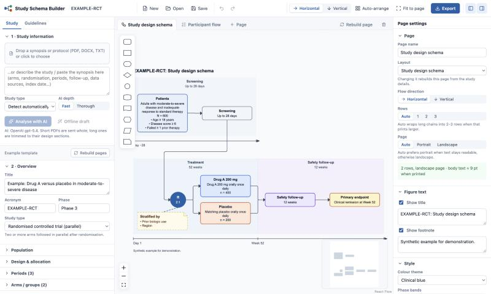

---

## Contents

1. [What it does](#what-it-does)
2. [Schema gallery](#schema-gallery)
3. [How it works](#how-it-works)
   - [Pipeline overview](#pipeline-overview)
   - [Reading the document and AI analysis](#1-reading-the-document-and-ai-analysis)
   - [The study model (data schema)](#2-the-study-model-data-schema)
   - [Generators: from study model to pages](#3-generators-from-study-model-to-pages)
   - [Layout engine](#4-layout-engine)
   - [Choosing rows, flow direction and page orientation](#5-choosing-rows-flow-direction-and-page-orientation)
   - [One rendering contract for canvas and exports](#6-one-rendering-contract-for-canvas-and-exports)
   - [Guideline checks](#7-guideline-checks)
   - [Exports](#8-exports)
4. [Using the app](#using-the-app)
5. [Running locally](#running-locally)
6. [Deployment (GitHub Pages)](#deployment-github-pages)
7. [Running on Domino](#running-on-domino)
8. [Project structure](#project-structure)
9. [Limitations](#limitations)
10. [References](#references)

---

## What it does

| | |
| --- | --- |
| **Input** | Upload a PDF, DOCX or TXT synopsis/protocol, or paste a description. Start from one of 14 example designs or a blank study. |
| **Analysis** | OpenAI extracts a structured *study model* (design, arms, periods, selection steps, lines of therapy, time windows, timeline, endpoints) with supporting quotes and a list of open questions. An offline keyword draft works without AI. |
| **Figures** | Five page layouts: study design schema, participant flow, treatment lines, time windows (RWE) and protocol timeline. A study gets the pages that suit its type; more can be added. |
| **Layout** | Horizontal (left → right) by default, or vertical. Long chains wrap into 2–4 rows. The page orientation follows the flow so text stays readable. |
| **Editing** | Full canvas editing: double-click text, add connected steps with one click, draw and re-route arrows, change shapes and colours, phase bands, alignment, undo/redo. |
| **Compliance** | Figure-level checks for SPIRIT 2025, CONSORT 2025, ICH M11, TREND, STROBE, RECORD, RECORD-PE, HARPER, the longitudinal design diagram, STARD 2015, PRISMA 2020 and ACCORD. |
| **Export** | PowerPoint with native editable shapes, Word (vector figure, one page per figure), PNG (2–4×) and SVG. The export dialog shows how large the text will print. |

Supported study types:

| Category | Study types |
| --- | --- |
| Interventional | Parallel RCT, crossover, factorial, single-arm, dose escalation / first-in-human, master protocols (platform / umbrella / basket) |
| Observational / RWE | Prospective cohort, retrospective database cohort, case-control, cross-sectional / survey, registry, external control arm, target trial emulation, treatment patterns |
| Diagnostic | Diagnostic accuracy |
| Evidence synthesis | Systematic review / meta-analysis |
| Consensus | Expert consensus (Delphi / nominal group / consensus meeting) |

---

## Schema gallery

All images below were exported by the app from its built-in synthetic examples (no real study data).

### Study design schema

The classic protocol figure: population → screening → allocation → arms → follow-up → primary endpoint. Study periods appear as **phase bands**, and an optional **timeline axis** shows timepoints. Randomisation is drawn as an **R** circle with the ratio, and stratification factors appear as an attached note. Used for **SPIRIT 2025** and **ICH M11 section 1.2 (Trial Schema)**.

| Horizontal (wrapped into two rows on a landscape page) | Vertical (portrait page) |
| --- | --- |
| 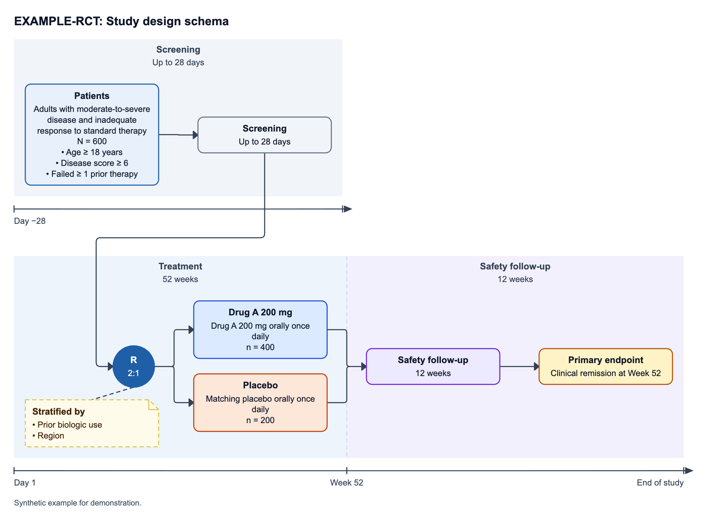 | 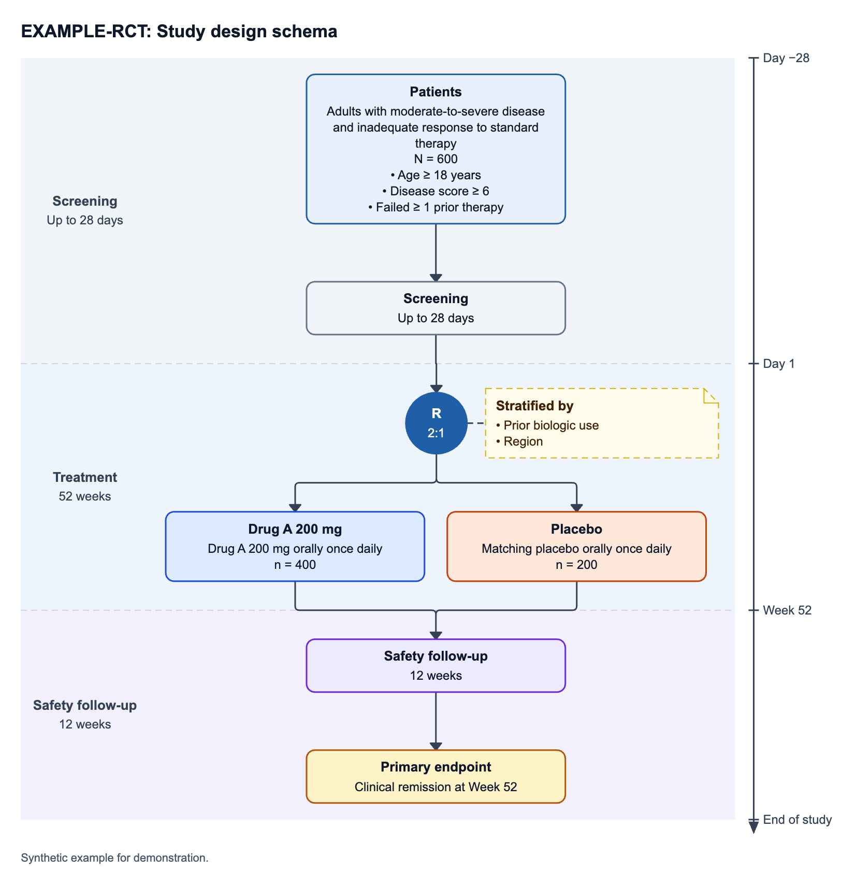 |

Design-specific variants are generated automatically:

| Crossover (sequences, periods, washout) | Dose escalation + expansion (sequential dose levels, RP2D, expansion cohorts) |
| --- | --- |
| 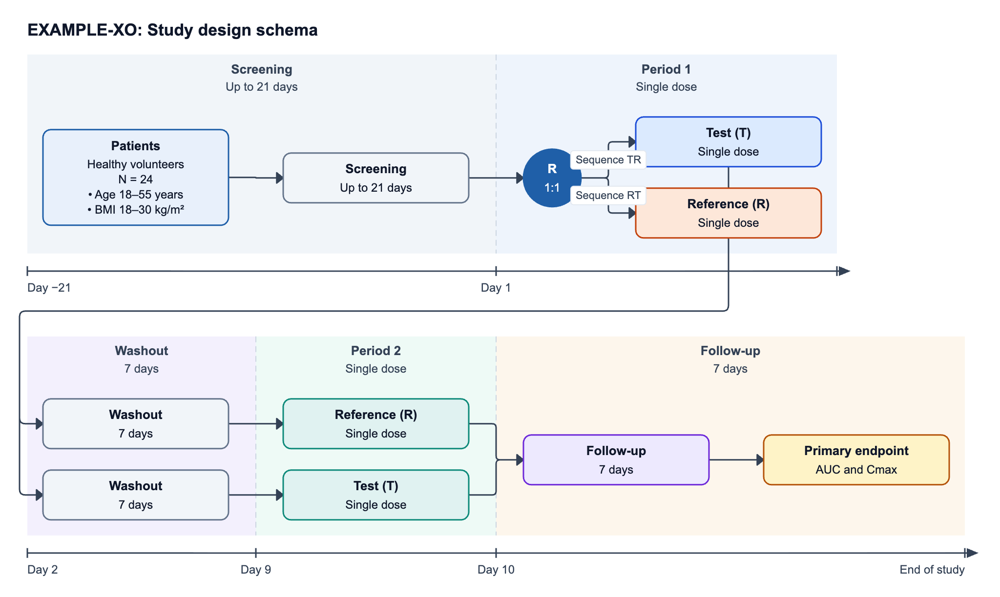 | 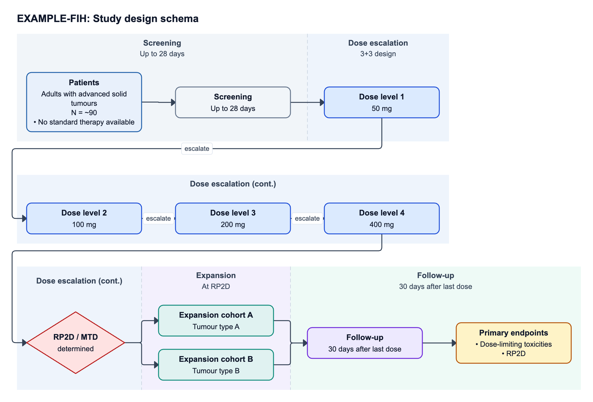 |

Master protocols get sub-study groups. Observational studies get a data-source box and exposure groups. Basket trials whose cohorts share a regimen state it once in an "All cohorts" note.

### Participant flow

The flow variant is chosen from the study type:

| Variant | Used for | Content |
| --- | --- | --- |
| **CONSORT** | Randomised trials | Assessed for eligibility → excluded (reasons) → randomised → allocated / follow-up / analysed per arm, with "(n = )" placeholders |
| **TREND** | Non-randomised interventional | As CONSORT, with enrolment instead of randomisation |
| **STROBE / RECORD** | Observational and database studies | Data source → stepwise selection with exclusion boxes → final cohort → exposure groups → analysed |
| **STARD** | Diagnostic accuracy | Eligible → index test → positive / negative / inconclusive → reference standard → final diagnosis |
| **PRISMA 2020** | Systematic reviews | Identification → screening → retrieval → eligibility → included, with exclusions at each step |
| **ACCORD** | Consensus studies | Experts invited → agreed → each round (responded / withdrew) → consensus meeting → statements reaching consensus |

| CONSORT (vertical) | PRISMA 2020 (vertical) |
| --- | --- |
| 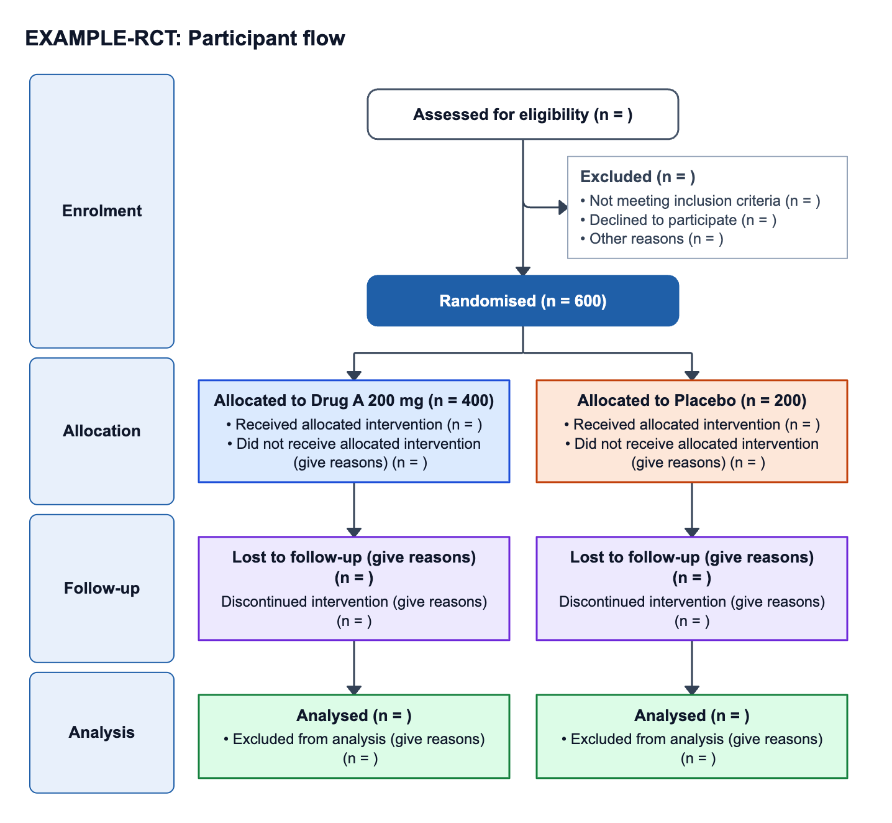 | 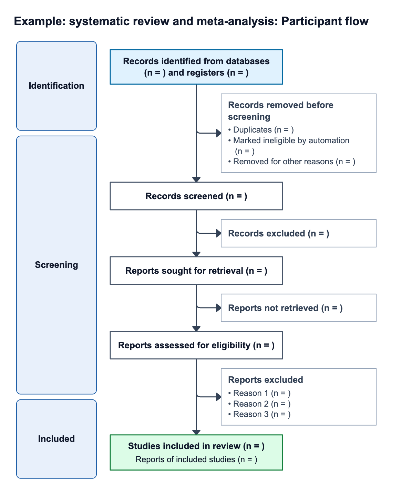 |

| STROBE / RECORD attrition, wrapped into rows | ACCORD participation per round |
| --- | --- |
| 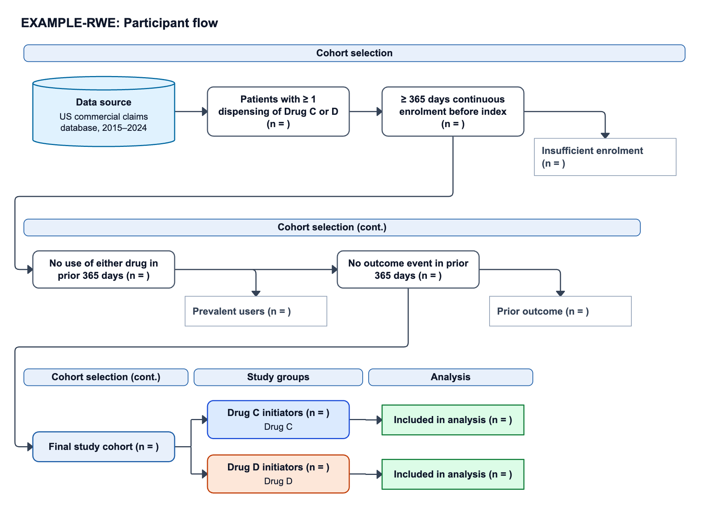 | 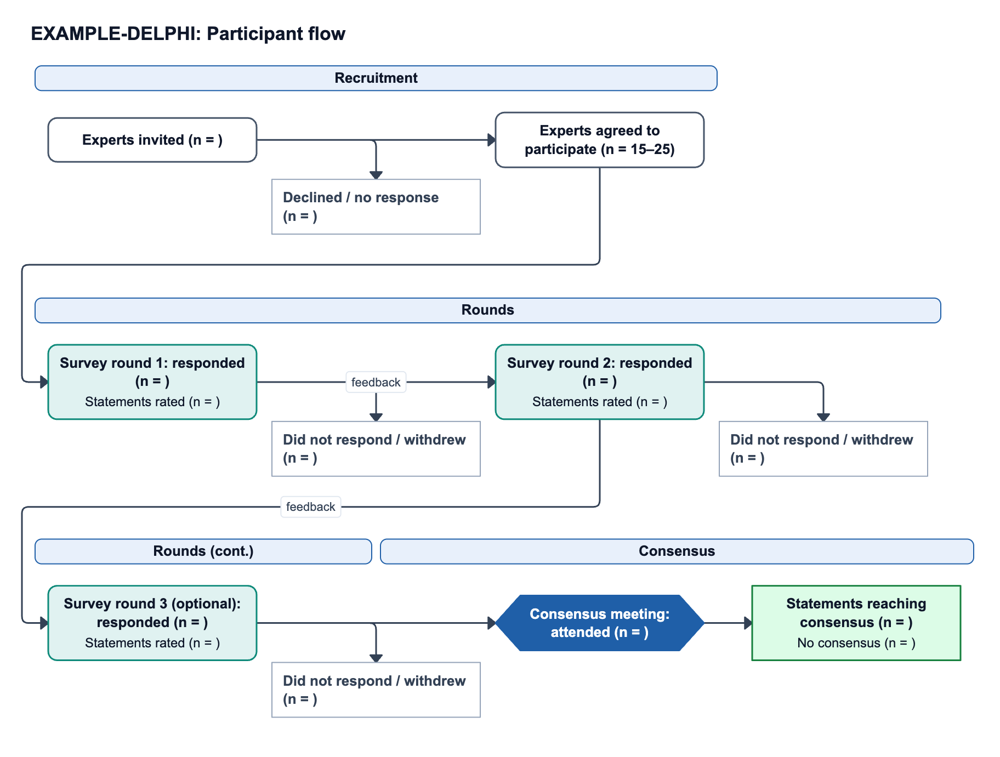 |

### Treatment lines

Lines of therapy as phases (1st line, 2nd line, …), with regimens per line and the transition event between lines (e.g. progression). The study treatment is highlighted. Used for treatment-pattern RWE studies.

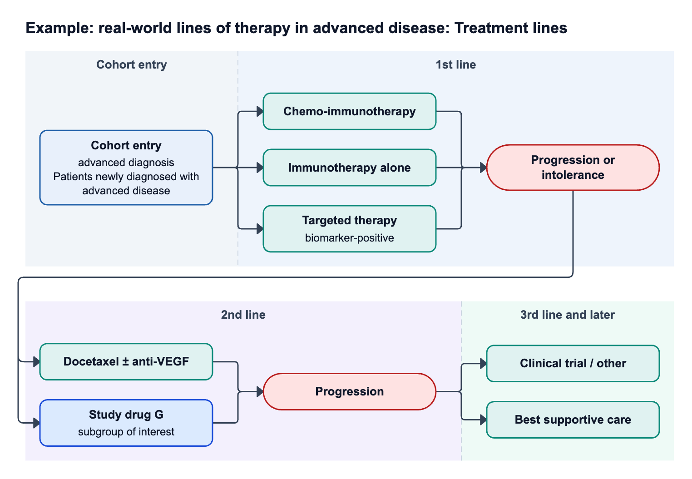

### Time windows (RWE design diagram)

A longitudinal design diagram anchored on the **index date (Day 0)**, following Schneeweiss et al. (2019): washout, exclusion assessment, covariate assessment, exposure assessment and follow-up windows, each with its day range. Open-ended follow-up ends in an arrow, and censoring rules go in the footnote. The day axis is **ordinal** (evenly spaced ticks), so short windows stay readable next to long ones. Used for **RECORD-PE**, **HARPER** and database studies.

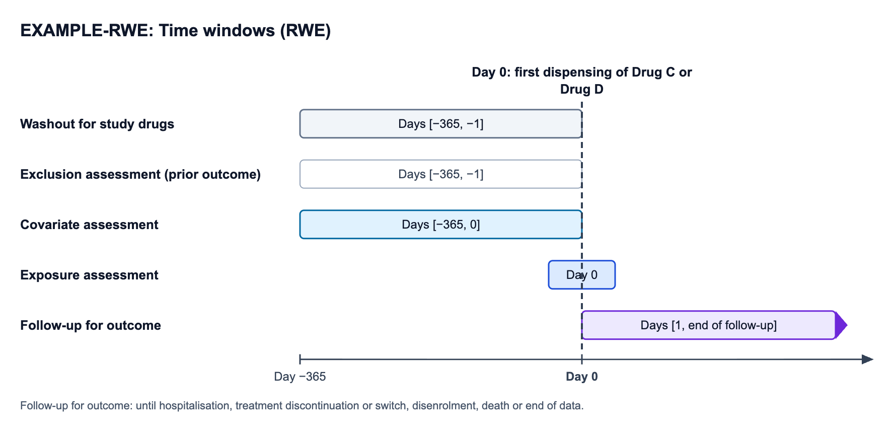

### Protocol timeline

Cohort **lanes** with treatment **bars on a true time axis**. It shows:
- **R** markers with ratios, and moves between lanes (e.g. responders and nonresponders)
- dashed **milestone lines** (e.g. response assessment) and **phase brackets**
- **compressed intervals (//)** for long stretches with no events, explained in a note

It suits designs where cohorts change treatment at defined times: randomised withdrawal, delayed start, crossover at progression, re-randomisation, stepped-wedge, extensions. It's an accepted way to draw the SPIRIT / ICH M11 trial schema, and the guideline checks count it as one.

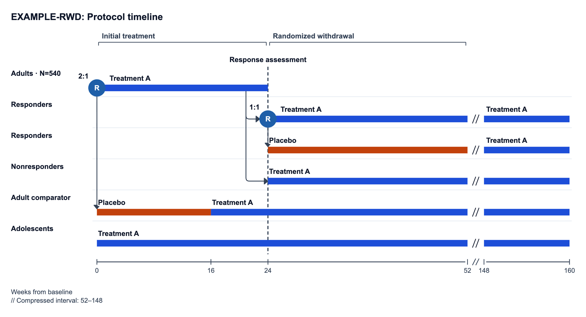

### Expert consensus (Delphi)

Expert panel → survey rounds with controlled feedback → optional round (dashed) → consensus meeting → report, with the consensus definition attached. It's paired with the ACCORD participation flow shown above.

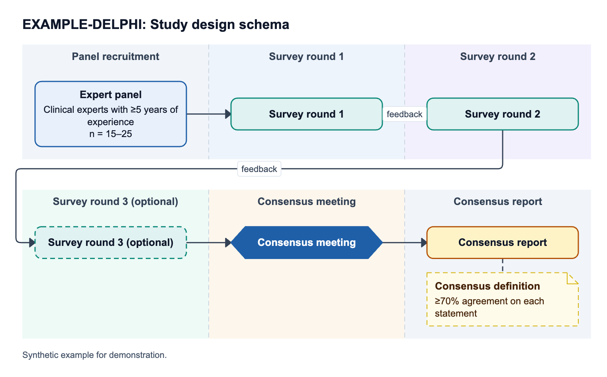

---

## How it works

### Pipeline overview

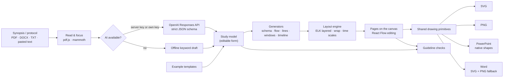

The key design decision is that the **study model**, not the drawing, is the source of truth for generation. You correct a fact once in the study-details form and click **Rebuild pages**, and every figure updates. After that, each page is freely editable on the canvas.

### 1. Reading the document and AI analysis

- **Reading** (`src/lib/readFile.ts`): PDFs are read with pdf.js (text per page) and DOCX files with mammoth.
  - A PDF of up to 40 pages and 20 MB is sent to the model **as the file itself**, so tables and schema figures inside it count.
  - Longer documents are **trimmed to their design-relevant sections**: the opening synopsis plus the paragraphs that score highest on design keywords (randomisation, arms, periods, follow-up, index date, eligibility…), up to about 110,000 characters.
- **Request** (`shared/prompt.mjs`): one call to the OpenAI **Responses API** with a **strict JSON schema** (`STUDY_SCHEMA`) and detailed instructions (`SYSTEM_PROMPT`). The main rules are:
  - use only what the document states; put anything missing in `openQuestions` instead of guessing
  - keep numbers exactly as written; never derive per-arm sizes from a total
  - classify the study type and the applicable reporting guidelines, and recommend 1–3 pages
  - never add a period for the overall study duration (it goes in the notes), and record events such as "treatment start" as events, not periods
  - fill `timeline` only when the protocol gives numeric timing
- **Depth**: *Fast* uses low reasoning effort (typically 15–30 s for a synopsis), *Thorough* uses medium.
- **Streaming**: progress (sending → reading → writing, elapsed seconds) is streamed to the UI.
- **Sanitising** (`sanitizeModel` in `src/lib/ai.ts`): every result is checked and repaired before use: enums are validated, ids made unique, crossover sequences cleared for non-crossover designs, and timeline links checked against existing lanes.
- **Where the key lives**:
  - *Local / own server*: `server/api.mjs` holds `OPENAI_API_KEY`; the browser never sees it.
  - *GitHub Pages*: there's no server, so visitors can paste **their own OpenAI key**. It stays in their browser (kept in storage only if they tick *Remember*) and is sent only to `api.openai.com`, with the same prompt and schema.
- **Offline draft** (`src/lib/localDraft.ts`): keyword rules detect the study type, randomisation, ratio, blinding, sample size, arms, periods and the primary endpoint. No data leaves the browser.

### 2. The study model (data schema)

All generators read one typed object, `StudyModel` (`src/types.ts`). The AI fills it, and you can edit it in the **Study** panel.

| Field | Meaning |
| --- | --- |
| `title`, `acronym`, `phase` | Identification |
| `studyType`, `studyTypeRationale` | One of the 17 supported types and why |
| `guidelines`, `recommendedLayouts` | Applicable reporting guidelines; the pages to create |
| `population` | Description, target N, key inclusion / exclusion |
| `design` | Randomised?, allocation ratio, blinding, stratification factors, control |
| `periods[]` | Chronological periods (`screening`, `run-in`, `treatment`, `washout`, `follow-up`, `extension`, …) with duration and start label (e.g. "Day 1") |
| `arms[]` | Arms / cohorts / exposure groups: kind, intervention, details, n, crossover `sequence`, sub-study `group` |
| `flowSteps[]` | Selection steps before the groups split, each with exclusions (reason, n) |
| `lines[]` | Lines of therapy: regimens and the transition to the next line |
| `windows[]`, `indexDate` | RWE windows relative to Day 0 (`startDay`, `endDay`, `null` = open) |
| `timeline` | Unit, lanes with segments (start, end, kind), links between lanes (randomised + ratio, or assignment), milestones, phases, compressed intervals |
| `endpoints` | Primary and key secondary endpoints |
| `dataSources`, `notes` | Data sources; footnotes and abbreviations |
| `openQuestions`, `evidence` | What the document doesn't state; verbatim supporting quotes |

Excerpt of a timeline (randomised withdrawal):

```json
{
  "unit": "weeks",
  "lanes": [
    { "id": "adults", "label": "Adults", "n": "540", "segments": [{ "label": "Treatment A", "start": 0, "end": 24, "kind": "active" }] },
    { "id": "respP", "label": "Responders", "n": null, "segments": [{ "label": "Placebo", "start": 24, "end": 52, "kind": "placebo" }] }
  ],
  "links": [{ "from": "adults", "at": 24, "to": ["respA", "respP"], "randomized": true, "ratio": "1:1" }],
  "milestones": [{ "at": 24, "label": "Response assessment" }],
  "breaks": [{ "from": 52, "to": 148 }]
}
```

A **project** (saved as `.schema.json`) holds the study model, the selected guidelines, the colour theme and the pages. Each page stores its nodes, edges, phases and settings.

### 3. Generators: from study model to pages

`src/lib/generate.ts` turns the model into nodes and edges, each with a **role** (population, allocation, experimental, control, follow-up, exclusion, data, note, …) that sets its theme colour.

- **Schema**:
  - Pre-treatment periods become a chain of boxes.
  - Allocation becomes an R circle (randomised) or a decision diamond (cohort or exposure assignment).
  - Each arm becomes a lane; crossover sequences become period-by-period chains, and dose levels become a sequential escalation chain.
  - Post-treatment periods merge the lanes, and the primary endpoint closes the chain.
  - Phases are ordered along the flow, which keeps the layout's phase partitions moving forward.
- **Flow**: chooses CONSORT / TREND / STROBE / STARD / PRISMA / ACCORD from the study type. Selection steps get side boxes with exclusion reasons and "(n = )" placeholders.
- **Lines**: one phase per line of therapy, with a transition node (pill) between lines.
- **Windows**: an index-date marker plus one row per window, colour-coded by kind. Placeholder windows (when none are given) are labelled as such.
- **Timeline**: lanes, bars, R markers with ratios, arrows for moves between lanes, and merged milestones. If the AI gave no timeline, it's derived from the periods: durations such as "up to 28 days" or "36 months" are parsed, and "until progression" becomes an open-ended bar.

### 4. Layout engine

`src/lib/layout.ts` and `src/lib/timeline.ts` work as follows:

- **Layered layout (schema, flow, lines)**: [ELK](https://eclipse.dev/elk/) layered algorithm.
  - Phases are **partitions**, so bands never overlap.
  - Model order is preserved, so arms keep their protocol order.
  - Nodes in a layer are centred.
- **Side boxes**: exclusion boxes sit **beside the main line between two steps** (the classic CONSORT T-junction), and the layout makes room if needed. Notes (stratification, consensus definition) hang directly under their anchor.
- **Arrows (handles)**: each arrow's attachment sides follow the flow direction. Elbow paths can be re-routed by dragging. Connectors between wrapped rows run along a dedicated lane and enter the next row from outside its bands.
- **Wrapping**: a long chain is split into 2–4 rows (or columns, in vertical mode). The break points are scored on:
  - widest row (the main factor)
  - number of arrows crossing the break (one is ideal)
  - not splitting a phase
  - not breaking right after a step that has a side box
  - evenly filled rows

  Each row gets its own bands ("(cont.)" when a phase continues) and its own timeline.
- **Time windows**: an ordinal day scale around Day 0. Windows ending at Day −1 or starting at Day 1 touch the index line, and a window that is only Day 0 gets a fixed small width.
- **Protocol timeline**: a linear time scale with **compressed intervals**:
  - Compression is automatic only for a long empty stretch between stated times, never at the axis start and never inside the drawn extension of an open-ended bar.
  - Open-ended treatment is drawn at least three times longer than screening.
  - Milestone labels at the same time are merged; nearby ones are staggered.
  - Lines pass behind labels, which have a white halo.
- **Auto-sizing**: box heights follow their wrapped text. Widths default to 190 px horizontally and 250 px vertically, or a fixed value set in page settings.

### 5. Choosing rows, flow direction and page orientation

Every layout run produces candidate layouts and picks one by the **printed body-text size** on the export page (A4 by default; 16:9 slides for PowerPoint in landscape).

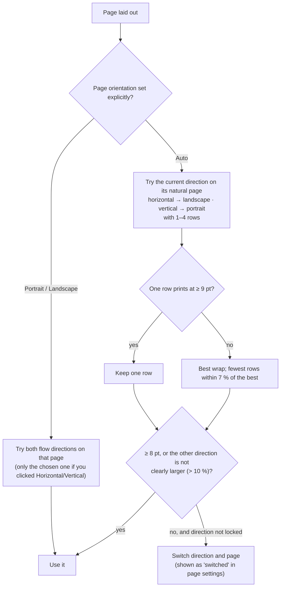

What the Study Schema tab must achieve inside Evidence CoPilot (real-life user cases in Study Synopsis & PED and Protocol Development, prioritised requirements, open decisions) is in **[docs/requirements.md](docs/requirements.md)**. How this prototype achieves it (every trigger, threshold, what survives each action, and acceptance tests) is in **[docs/layout-behaviour-spec.md](docs/layout-behaviour-spec.md)**.

So **the flow direction and the page always agree**: a horizontal figure is never squeezed into stacked rows on a portrait page unless you ask for that combination explicitly. **Fit to page** additionally tries several box widths and spacings and keeps the best result.

### 6. One rendering contract for canvas and exports

Every node, phase band, axis, title and footnote is described once as **drawing primitives** (`src/lib/prims.ts`, `shapes.ts`, `decor.ts`): paths, rectangles, lines and pre-wrapped text measured with the same font metrics.

- The **canvas** renders those primitives as React SVG inside React Flow nodes.
- **SVG** export serialises the same primitives. **PNG** rasterises that SVG.
- **PowerPoint** maps nodes to native shapes with text (rectangle, rounded rectangle, diamond, ellipse, hexagon, document, can …), primitives to native lines and custom geometry, and arrows to native lines with arrowheads.

Arrow geometry comes from the same functions on screen and in exports, and connection handles have zero size, so arrows end exactly on box borders in both.

### 7. Guideline checks

The **Guidelines** tab (`src/lib/checks.ts`) checks what the figures show (pass / warn / fail / info), with one-click fixes such as *Add flow page*.

| Guideline | Example items |
| --- | --- |
| SPIRIT 2025 | Schema figure; eligible population and target N; allocation method and ratio; interventions per arm; period timing; primary outcome |
| CONSORT 2025 | Flow diagram; enrolment with exclusion reasons; allocation, follow-up and analysis per group |
| ICH M11 | Trial schema (section 1.2) with periods, arms and allocation |
| TREND | Flow diagram; assignment shown |
| STROBE | Flow diagram (item 13c); numbers at each stage (13a); reasons for non-participation (13b) |
| RECORD | Selection incl. data quality, availability and linkage (13.1); data sources; linkage |
| RECORD-PE / HARPER / design diagram | Design diagram anchored on the index date; exposure, covariate and follow-up windows; washout / new-user definition; time axis |
| STARD 2015 | Flow diagram (item 19); index-test results by category; reference standard |
| PRISMA 2020 | Flow diagram (item 16a): identified, screened, assessed, excluded with reasons, included |
| ACCORD | Consensus process shown; participation at each round; consensus definition |

These checks cover the figures only; they don't replace the full reporting checklists. The schedule of activities / assessments is intentionally out of scope (the target platform has a dedicated SoA tab).

### 8. Exports

| Format | Details |
| --- | --- |
| **PowerPoint** | Native, editable shapes, text and arrows; one slide per page. The slide follows the page orientation (16:9 for landscape, A4 portrait for portrait, or a chosen size). A picture-only mode is also available. |
| **Word** | One section per page with its own orientation (A4 or Letter, 15 mm margins). The figure is SVG with a high-resolution PNG fallback, fitted to the page. |
| **PNG** | 2×, 3× or 4×; white or transparent background |
| **SVG** | Vector with real text (Arial), for Illustrator, Inkscape or the web |

---

## Using the app

1. **Start**: drop a synopsis or protocol into *Study information*, or paste text. Choose *Analyse with AI* or *Offline draft*, or pick an example under **New**.
2. **Review**: check *Check before use* (open questions and supporting quotes) and correct the study details. Click **Rebuild pages** after changing them.
3. **Arrange**: switch **Horizontal / Vertical**, set **Rows** and **Page** in page settings, use **Auto-arrange** or **Fit to page**, and add pages with **+ Page**.
4. **Edit** on the canvas (below), then check the **Guidelines** tab.
5. **Export** to PowerPoint, Word, PNG or SVG. **Save** writes a `.schema.json` project file; **Open** loads one. The current project is also kept in the browser.

| Action | How |
| --- | --- |
| Edit box text | Double-click (Enter saves, Shift+Enter adds a line) or use the inspector |
| Add a connected step | Select a box, click a blue **+** on any side |
| Add a shape | Click or drag from the palette (box, decision, R, data source, document, note, …) |
| Draw / re-attach an arrow | Drag between connection dots; drag an arrow end to another dot |
| Re-route an elbow arrow | Select it and drag the round middle handle |
| Phase bands | Click a band to rename it, set duration and timeline label, recolour or reorder it |
| Timeline bars | Click a bar to change label, start, end (blank = open-ended) and meaning |
| Multi-select | Drag on empty canvas; align, distribute or set the same width in the inspector |
| Pan / zoom | Scroll to pan; pinch or ⌘/Ctrl+scroll to zoom |
| Shortcuts | ⌘/Ctrl+Z undo, ⇧⌘Z redo, ⌘D duplicate, ⌘C/⌘V copy/paste, Delete removes, Enter edits |

Colour themes: Clinical blue, Print grayscale, Soft pastel, Bold corporate, Outline only.

---

## Running locally

Requirements: Node.js 20+.

```sh
npm install
npm run dev            # http://127.0.0.1:5181 (Vite dev server + local API)
```

Production build with the local API server:

```sh
npm run build
npm start              # serves dist/ and /api on http://127.0.0.1:5181
```

AI configuration (kept on the server, never sent to the browser):

| Setting | Meaning |
| --- | --- |
| `OPENAI_API_KEY` | OpenAI key. Looked up in this order: environment variable → `.env.local` in the project folder → `../study-schema/.env.local` |
| `STUDIO_AI_MODEL` | Model name (default `gpt-5.4`) |
| `STUDIO_ENV_FILE` | Path to an alternative env file |
| `PORT` | Port for `npm start` (default 5181) |
| `HOST` | Interface for `npm start` (default `127.0.0.1`; `0.0.0.0` in containers such as Domino) |
| `OPENAI_BASE_URL` | Optional OpenAI-compatible endpoint (default `https://api.openai.com/v1`) |

`.env.local` is git-ignored. Without a key, the app still offers offline drafts, templates, editing and all exports, and visitors can use their own key.

---

## Deployment (GitHub Pages)

`.github/workflows/deploy.yml` builds and deploys on every push to `main`:

1. `npm ci`, then `npm run build` (typecheck + Vite build) with `BASE_PATH=/<repo>/`
2. Upload `dist/` as the Pages artifact and deploy it with `actions/deploy-pages`

GitHub Pages hosts static files only, so the `/api` server doesn't run there. The app detects this and offers **bring your own OpenAI key**: requests go directly from the visitor's browser to `api.openai.com`, with the same prompt and output schema as the server. No key is stored in the repository or the build.

---

## Running on Domino

The repository is ready to run as a **Domino App**, including Domino's standard environment, which has no Node.js:

- `app.sh` (repo root) starts **`server/serve.py`** on **`0.0.0.0:8888`**, the address Domino Apps expect. The server uses only the Python standard library and serves the **prebuilt app in `domino/app/`**, so start-up needs no Node.js, npm or package downloads.
- It provides the same API as the Node server (`/api/health`, streamed `/api/analyze`), with the same AI instructions and output schema (`domino/app/prompt.json`, exported from `shared/prompt.mjs`).
- Asset and API paths are relative, and both servers ignore any leading URL prefix, so the app works behind Domino's app proxy (`/<user>/<project>/r/...`).

| Environment variable | Purpose |
| --- | --- |
| `OPENAI_API_KEY` | OpenAI key for AI analysis (kept server-side; never commit it) |
| `STUDIO_AI_MODEL` | Optional model name (default `gpt-5.4`) |
| `OPENAI_BASE_URL` | Optional OpenAI-compatible endpoint, e.g. a corporate gateway (default `https://api.openai.com/v1`) |
| `HTTPS_PROXY` | Optional outbound proxy, if your network requires one |
| `SSB_BUILD=1` | Optional: build from source with Node.js 20+ instead of using the prebuilt app |

**Keeping the prebuilt app current:** after changing the source, run `npm run build:domino` and commit `domino/app/`. Domino serves whatever is committed there.

### 1. Git credentials (only if needed)

This repository is public, so Domino can **import and pull it without credentials**. Add a credential only if Domino should **push changes back** to GitHub, or if the repository becomes private.

**Create a classic personal access token on GitHub.** Domino's Git integration works most reliably with classic tokens:

1. Open https://github.com/settings/tokens/new?scopes=repo&description=Domino%20study-schema-builder (this pre-fills the note and the `repo` scope).
2. Choose an expiration (e.g. 90 days) and click **Generate token**.
3. Copy the token (starts with `ghp_`). GitHub shows it only once.

A classic token with `repo` scope can access all repositories you can access. Give it an expiry, keep it only in Domino, and revoke it at https://github.com/settings/tokens if it leaks.

**Add it to Domino**: open your user menu → **Account Settings** → **Git Credentials** → **Add credential**:

| Field | Value |
| --- | --- |
| Domain / Git service | `github.com` |
| Credential type | **Personal Access Token** (HTTPS) |
| Username | `mnikor` |
| Token | the `ghp_…` token |

Labels can differ slightly between Domino versions. Use the **HTTPS** repository URL with this credential (not the `git@github.com:` SSH form).

### 2. Create the project from the repository

In Domino, create a **new project** backed by Git (*Git-based project* / *import a Git repository*), using
`https://github.com/mnikor/study-schema-builder.git`, and select the credential from step 1. For an existing project, open the project's Git repository settings and switch it to the new credential.

### 3. Compute environment

Any environment with **Python 3.8+** works, including the Domino Standard Environment. Node.js is needed only if you set `SSB_BUILD=1`. Note that software installed inside a running workspace doesn't carry over to apps; apps start from the environment image.

### 4. Publish the app

1. Add `OPENAI_API_KEY` under **Project settings → Hardware & Environment → Environment variables** (or under your account's user environment variables, to keep it personal).
2. Publish the app (*Deployments → Apps & Agents → Publish*). Choose **`/mnt/code`** and the file **`app.sh`**, keep the default branch, and pick a hardware tier (`general.medium` is enough).
3. Open the app. The left panel shows "AI: OpenAI …" when the key is picked up. Without a key, the app still runs with offline drafts, templates, editing and exports.

If the app doesn't start, open its logs in Domino. A line such as `Could not reach https://api.openai.com/v1` means the network blocks OpenAI; set `OPENAI_BASE_URL` (corporate gateway) or `HTTPS_PROXY`.

---

## Project structure

```text
schema-builder/
├─ app.sh                   # Domino App entry point (Python server on 0.0.0.0:8888)
├─ domino/app/              # prebuilt app + prompt.json served on Domino (npm run build:domino)
├─ index.html
├─ vite.config.ts            # dev server + local API middleware, Pages base path
├─ shared/
│  ├─ enums.json             # study types, guidelines, layouts, period/arm/window kinds
│  └─ prompt.mjs (+ .d.mts)  # AI instructions + strict JSON schema (server and browser)
├─ server/
│  ├─ api.mjs                # /api/health, /api/analyze (OpenAI, streamed NDJSON)
│  ├─ serve.mjs              # production static server + API (Node)
│  └─ serve.py               # same server in pure Python (Domino, no Node.js)
├─ src/
│  ├─ types.ts               # StudyModel, Diagram, nodes, edges, timeline types
│  ├─ store.ts               # zustand store: project, undo/redo, layout actions, autosave
│  ├─ lib/
│  │  ├─ catalog.ts          # study types, guidelines + references, layouts, themes
│  │  ├─ ai.ts               # server call, bring-your-own-key call, sanitiser
│  │  ├─ readFile.ts         # PDF/DOCX/TXT reading, section focusing
│  │  ├─ localDraft.ts       # offline keyword extraction
│  │  ├─ generate.ts         # study model → pages (schema, flow, lines, windows, timeline)
│  │  ├─ timeline.ts         # timeline derivation, time scale, compressed intervals
│  │  ├─ layout.ts           # ELK layout, side boxes, wrapping, direction/page choice
│  │  ├─ decor.ts            # phase bands, axes, brackets, title, footnote
│  │  ├─ shapes.ts           # shape outlines, auto-size, node primitives
│  │  ├─ edges.ts            # arrow geometry (step, straight, curve, wrap, timeline)
│  │  ├─ prims.ts / text.ts  # drawing primitives, text measuring and wrapping
│  │  ├─ checks.ts           # guideline checks
│  │  └─ templates.ts        # 14 synthetic example studies
│  ├─ canvas/                # React Flow canvas, node renderers, editable edge, actions
│  ├─ components/            # top bar, page tabs, study panel, inspector, checks, dialogs
│  └─ export/                # scene, SVG, PNG, PowerPoint, Word
├─ docs/
│  ├─ requirements.md        # Evidence CoPilot user cases, prioritised requirements, open decisions
│  ├─ layout-behaviour-spec.md # prototype's rules (reference implementation) + tests
│  └─ images/                # gallery images used in this README
└─ .github/workflows/deploy.yml
```

Main libraries: React 19, React Flow (`@xyflow/react`), elkjs, zustand, pptxgenjs, docx, pdf.js, mammoth, lucide-react, Vite and TypeScript.

---

## Limitations

- AI output must be reviewed. The app lists open questions and quotes, but it can't guarantee completeness, and placeholders such as "(n = )" are meant to be filled in.
- PowerPoint and Word re-flow text with their own font engines, so line breaks can differ slightly from the canvas.
- Protocol timelines always run left to right.
- Very large diagrams can still print below 8 pt. The export dialog warns, and *Fit to page*, a different orientation or shorter box text help.
- In bring-your-own-key mode, OpenAI usage is billed to the visitor's own account.

---

## References

- Chan A-W, et al. SPIRIT 2025 statement: updated guideline for protocols of randomised trials. 2025.
- Hopewell S, et al. CONSORT 2025 statement: updated guideline for reporting randomised trials. 2025.
- ICH M11 Clinical electronic Structured Harmonised Protocol (CeSHarP) template.
- Des Jarlais DC, et al. The TREND statement. Am J Public Health 2004;94:361–6.
- von Elm E, et al. The STROBE statement. Lancet 2007;370:1453–7.
- Benchimol EI, et al. The RECORD statement. PLoS Med 2015;12:e1001885.
- Langan SM, et al. The RECORD-PE statement. BMJ 2018;363:k3532.
- Wang SV, et al. HARmonized Protocol Template to Enhance Reproducibility (HARPER). Pharmacoepidemiol Drug Saf 2022.
- Schneeweiss S, et al. Graphical depiction of longitudinal study designs in health care databases. Ann Intern Med 2019;170:398–406.
- Bossuyt PM, et al. STARD 2015. BMJ 2015;351:h5527.
- Page MJ, et al. The PRISMA 2020 statement. BMJ 2021;372:n71.
- Gattrell WT, et al. ACCORD (ACcurate COnsensus Reporting Document): a reporting guideline for consensus methods in biomedicine. PLoS Med 2024.
