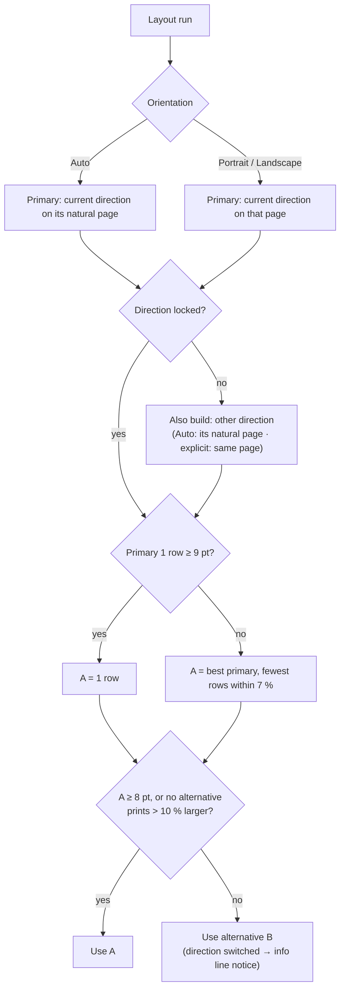

# Layout behaviour specification

How the current prototype decides **flow direction, page orientation, rows and positions**, and what happens when the user changes any of them.

> **Reference implementation, not the requirements.** The requirements, scenarios and priorities are in [`requirements.md`](requirements.md). This document records one way of meeting them: the prototype's actual behaviour, useful as a worked example and for regression testing of the prototype. Algorithms, thresholds and visual devices here are implementation choices that may be replaced, provided requirements R1–R18 are met. In this document, "must" describes how the prototype behaves.


- **Status:** describes the behaviour of `main` as of October 2026.
- **Normative language:** *must* = required behaviour; *should* = intended default that may be tuned.
- **Source of truth in code:** `src/lib/layout.ts` (`layoutDiagram`, `pick`, `bestOf`, `wrapRows`, `assignHandles`, `fitToPage`, `pageSize`, `orientationOf`), `src/store.ts` (`setDirection`, `relayout`, `fitPage`, `regeneratePage`, `rebuildAll`), `src/lib/decor.ts` (bands, axes), `src/lib/timeline.ts`, `src/components/Inspector.tsx` and `ExportDialog.tsx` (controls).
- Rule IDs (e.g. **R-DIR-2**) are referenced from code comments and tests. Keep them stable when editing.

---

## 1. Concepts and state

Each page (a `Diagram`) carries this layout-relevant state:

| State | Type / values | Set by | Meaning |
| --- | --- | --- | --- |
| `direction` | `'LR'` (horizontal) · `'TB'` (vertical) | Generator (default `LR`), direction control, Auto (when unlocked) | Direction the flow reads. The UI shows it as **Horizontal / Vertical**. |
| `settings.lockDirection` | boolean | `true` when the user clicks Horizontal/Vertical; `false` when the user picks a Page orientation | When `true`, layout must never change `direction`. |
| `settings.orientation` | `'auto'` · `'portrait'` · `'landscape'` | Page control (page settings and export dialog) | Page orientation request. `auto` = decided by layout. |
| `settings.rows` | `0` (Auto) · `1`–`4` | Rows/Columns control | Number of rows (LR) or columns (TB) to wrap into. `0` = decided by layout. |
| `settings.page` | `'auto'` · `'a4'` · `'letter'` · `'slide16x9'` · `'slide4x3'` | Page size select (export dialog) | Paper used to judge print size and for export. |
| `settings.fontSize`, `nodeWidth` (0 = auto), `rankGap`, `nodeGap` | numbers | Page settings → Style | Typography and spacing inputs to layout. |
| `layoutInfo` | `{ rows, orientation, bodyPt, adapted? }` | Written by every layout run | What the last layout resolved. Drives the info line and export orientation. Read-only for the UI. |
| node `data.fixedSize` | boolean | Resizing a box by hand, *Same width* | Layout keeps this box's width/height instead of auto-sizing it. |
| node `data.row` | number or undefined | Wrap step | Row (LR) / column (TB) the node belongs to after wrapping. |
| node `data.side` | boolean | Generator / "Side box" toggle | Box placed beside the flow (exclusions, notes), not in it. |
| edge `data.manualHandles` | boolean | Drawing or re-attaching an arrow by hand | Layout keeps the arrow's chosen attachment sides. |
| edge `data.offset` | `{x, y}` | Dragging an elbow arrow's middle handle | Manual re-route of the arrow's middle segment. |
| edge `data.wrap` | `{ lane }` | Wrap step | Arrow connects two wrapped rows and runs along the lane between them. |

Derived helper: **`orientationOf(page)`** = `settings.orientation` if it isn't `auto`; else `layoutInfo.orientation`; else `landscape` for `LR` and `portrait` for `TB`. Exports must use this value.

---

## 2. Definitions

### 2.1 Natural page

| Flow direction | Natural page |
| --- | --- |
| Horizontal (`LR`) | Landscape |
| Vertical (`TB`) | Portrait |

### 2.2 Printed body size

A layout candidate is judged by the **printed size of body text** (detail text, one point below `fontSize`) when the whole figure is scaled to fit the page:

```
scale_mm_per_px = min((pageW_mm − 24) / figureW_px, (pageH_mm − 24) / figureH_px)   // 12 mm margins
bodyPt          = (fontSize − 1) × scale_mm_per_px × 72 / 25.4                        // rounded to 0.1
```

`figureW/H` is the bounding box of nodes, phase bands, axes, title and footnote.

### 2.3 Page sizes (mm, landscape; portrait swaps them)

| `page` | Size | Used when judging layout | Used in export |
| --- | --- | --- | --- |
| `auto` | A4 | always A4 | **PowerPoint:** 16:9 slide in landscape, A4 portrait in portrait. **Word:** A4. |
| `a4` | 297 × 210 | A4 | A4 |
| `letter` | 279.4 × 215.9 | Letter | Letter |
| `slide16x9` | 338.7 × 190.5 | 16:9 | PowerPoint as chosen; **Word falls back to A4** |
| `slide4x3` | 254 × 190.5 | 4:3 | PowerPoint as chosen; **Word falls back to A4** |

### 2.4 Thresholds (constants)

| Constant | Value | Where |
| --- | --- | --- |
| Readable body text | **8 pt** | `pick` |
| Keep a single row if it prints at least | **9 pt** | `pick` |
| Alternative must print larger by more than | **10 %** (`b.s > a.s × 1.1`) | `pick` |
| Near-equal options (prefer fewer rows) | within **7 %** of the best (`≥ 0.93 × best`) | `bestOf` |
| Maximum rows/columns | **4** (Auto tries 1–4; manual 1–4) | `variantsFor`, Rows control |
| Minimum columns to attempt `k` rows | **2 × k** (Auto and manual) | `wrapRows` |
| Minimum columns in each wrapped row | **2** in Auto; **1** when rows are set manually | `wrapRows` |
| Warning style on info line / export dialog | below **7 pt** | `Inspector`, `ExportDialog` |
| Default box width | **190 px** (LR) · **250 px** (TB) | `defaultWidth` |
| Lane between wrapped rows | **26 px** + band/axis space | `WRAP_LANE`, `laneOffset` |

---

## 3. Rules

### 3.1 Flow direction (Horizontal / Vertical)

- **R-DIR-1 — Clicking a direction locks it.** Clicking Horizontal or Vertical (top bar or page settings) must set `lockDirection = true`.
- **R-DIR-2 — Changing direction rebuilds positions.** If the clicked direction differs from the current one, the page must:
  1. set `direction` to the new value;
  2. clear `fixedSize` on all boxes (they re-size to the new default widths);
  3. clear `manualHandles` and `offset` on all arrows;
  4. run a full layout (§3.4) and fit the view.

  Text, colours, shapes, roles, phases and the set of nodes/edges must be unchanged.
- **R-DIR-3 — Clicking the current direction** only sets `lockDirection = true`; no re-layout.
- **R-DIR-4 — Timeline pages are horizontal only.** Clicking Vertical on a protocol timeline must leave the page unchanged and show the toast *"Protocol timelines run left to right; use Page → Portrait to fit a portrait page."*
- **R-DIR-5 — Auto may switch direction only when unlocked** (see R-PICK-4). The UI must then show the new direction as selected, and the info line must say *"flow switched to horizontal/vertical to suit the page"*.

### 3.2 Page orientation (Auto / Portrait / Landscape)

- **R-PAGE-1 — Choosing a page orientation unlocks the direction.** Selecting Auto, Portrait or Landscape (page settings or export dialog) must set `settings.orientation` and `lockDirection = false`, then re-layout.
- **R-PAGE-2 — Auto orientation** tries the current direction on its **natural page** and, if unlocked, the other direction on *its* natural page. A horizontal figure must never land on a portrait page while orientation is Auto, and vice versa.
- **R-PAGE-3 — Explicit orientation** (Portrait or Landscape) tries the current direction on that page and, if unlocked, the other direction on that page too. This is how *Portrait* turns a horizontal figure into a vertical one when that prints larger.
- **R-PAGE-4 — Page size** changes (export dialog) must re-layout, because print size is judged on that page.

### 3.3 Rows / columns

- **R-ROWS-1** — `rows = 0` (Auto): layout tries 1, 2, 3 and 4 rows. `rows = k`: layout tries only `k`.
- **R-ROWS-2** — Wrapping applies only to **schema, flow and lines** pages. Time-window and timeline pages are always one row. The Rows control must only be shown for schema, flow and lines.
- **R-ROWS-3** — If `k` rows are impossible (fewer than `2k` columns, or no valid cut), layout falls back to one row. The info line must show the rows actually used.
- **R-ROWS-4** — In vertical mode the same setting wraps into **columns**, and the control is labelled *Columns*.

### 3.4 Choosing the layout (pick)

Every layout run builds candidates = {direction, page orientation, rows} per §3.2 and §3.3, computes `bodyPt` for each, then:

- **R-PICK-1 — Primary set:** candidates with the current direction on the requested page (explicit orientation) or its natural page (Auto). For timelines: the requested page, or landscape on Auto.
- **R-PICK-2 — Single row first:** if the primary single-row candidate prints at **≥ 9 pt**, it's the primary choice *A*.
- **R-PICK-3 — Otherwise** *A* = the primary candidate with the largest print, preferring **fewer rows** among those within **7 %** of the best.
- **R-PICK-4 — Alternative:** *B* = best non-primary candidate, chosen the same way. Use *B* only if *A* prints below **8 pt** **and** *B* prints more than **10 %** larger. Otherwise use *A*.
- **R-PICK-5 — Result:** the chosen candidate's `direction` becomes the page direction (only differs when unlocked, R-DIR-5). `layoutInfo` = `{ rows, orientation, bodyPt, adapted: direction changed }`.



### 3.5 Wrapping into rows (LR) or columns (TB)

- **R-WRAP-1 — Columns:** main-flow boxes whose main-axis ranges overlap form one column. Side boxes belong to their anchor's column.
- **R-WRAP-2 — Cut choice:** among all ways to cut the column sequence into `k` contiguous rows (each with ≥ 2 columns in Auto), choose the lowest score:

  ```
  score = widestRow × (1 + Σ penalties) + 0.2 × (widestRow − narrowestRow)
  penalties per cut: +0.25 for each crossing arrow beyond the first
                     +0.5  if no arrow crosses (disconnected cut)
                     +0.08 if the cut splits a phase
                     +0.3  if the column before the cut has a side box
  ```
- **R-WRAP-3 — Placement:** each row starts at the left (LR) / top (TB). Rows stack with a gap that fits the previous row's band padding and axis, a **26 px connector lane**, and the next row's band header.
- **R-WRAP-4 — Connectors:** an arrow from row *r* to a later row must leave the source's bottom (LR) / right side (TB), run along the lane, and enter the target from **24 px outside** its left (LR) / top (TB) edge. Dragging the middle handle moves the lane segment.
- **R-WRAP-5 — Bands per row:** each row gets its own phase bands. A phase continuing from an earlier row is labelled *"<label> (cont.)"* without its duration. The outer bands of a row also cover side boxes that stick out.
- **R-WRAP-6 — Axis per row:** each row gets its own timeline axis. A phase start label is shown only in the first row where the phase appears, and the end label only in the last row. Labels repeated within a row are shown once. In a wrapped page, a row whose ticks would all be unlabelled gets no axis.

### 3.6 Positions, side boxes and arrows

- **R-POS-1 — Layered layout** (schema, flow, lines) uses ELK layered with phases as ordered partitions, so phases never interleave. Boxes in a layer are centred on the layer's axis, and the protocol order of arms is kept.
- **R-POS-2 — Exclusion side boxes** sit beside the main line, midway between their anchor and its successor, offset 36 px to the cross side. The gap between the two steps grows if needed.
- **R-POS-3 — Notes** (role *note*, e.g. stratification, consensus definition) hang under (LR) / beside (TB) their anchor, never past the anchor's far edge.
- **R-POS-4 — Arrow sides** are chosen per direction unless `manualHandles` is set:
  - forward: right → left (LR) / bottom → top (TB)
  - backward: bottom → bottom (LR) / right → right (TB)
  - same layer: towards the other box
  - side box: from the main line into the side box
- **R-POS-5 — Time-window pages:** LR draws one row per window with day ranges on an ordinal axis around Day 0; TB draws one column per window with time running down.
- **R-POS-6 — Timeline pages:** one lane per cohort on a linear time axis, with compressed intervals (see README *Protocol timeline*). Always left to right.

### 3.7 What re-runs layout

| User action | Effect |
| --- | --- |
| Click Horizontal/Vertical (different) | Full layout with resets (R-DIR-2) |
| Page orientation (page settings or export dialog) | Full layout (R-PAGE-1) |
| Page size (export dialog) | Full layout (R-PAGE-4) |
| Rows/Columns | Full layout |
| Font size, Box width, Spacing sliders | Full layout, debounced **280 ms** |
| Auto-arrange | Full layout with current settings |
| Fit to page | Tries box widths (LR 150–250, TB 180–330) × two spacings (44/18, 64/26), each through the full pick, and keeps the best per R-PICK |
| Phase reorder; time-window days/label; timeline bar times/label/meaning; milestone time; timeline unit or compressed intervals | Full layout, debounced 280 ms |
| Edit box text (inline or inspector), box font size, shape, role, side-box toggle | **Resize that box only**; positions unchanged (may overlap until Auto-arrange) |
| Drag a box, resize a box, draw/re-attach/re-route an arrow | No layout; stored as manual edits |
| Title, footnote, band style, axis on/off, colours, theme, page name | **Redraw only** (bands, axis, captions recomputed live); no layout |

After any full layout the canvas must fit the view to the page.

### 3.8 What survives what

| State | Full layout (Auto-arrange, settings) | Direction change | Rebuild page / Rebuild pages | Change page Layout |
| --- | --- | --- | --- | --- |
| Box positions dragged by hand | **Lost** (recomputed) | Lost | Lost | Lost |
| Hand-resized box size (`fixedSize`) | Kept | **Reset** | Lost (new boxes) | Lost |
| Arrow attachments set by hand (`manualHandles`) | Kept | **Reset** | Lost | Lost |
| Arrow middle re-route (`offset`) | Kept on manual arrows; reset on others | Reset | Lost | Lost |
| Text, colours, shapes, roles | Kept | Kept | **Regenerated from study details** | Regenerated |
| `direction` | Kept unless unlocked Auto switches it | New value | Kept | Kept (timeline forces horizontal) |
| `rows`, `orientation`, `lockDirection`, `page`, `fontSize` | Kept | Kept (lock set) | **Kept** (R-REBUILD) | **Kept** (R-REBUILD) |
| Title, footnote, band style | Kept | Kept | Same-layout rebuild keeps band style and title on/off; texts regenerated | Defaults for the new layout |

- **R-REBUILD** — Rebuild page, Rebuild pages and changing a page's Layout must keep `fontSize`, `page`, `rows`, `orientation` and `lockDirection`.
- **R-CONFIRM** — Changing Layout or rebuilding a page that has manual edits (`edited = true`) must ask for confirmation first. All of these actions must be undoable.

### 3.9 UI feedback

- **R-UI-1 — Info line** (page settings, below Page) must read:
  `"<n> row(s)|column(s), <portrait|landscape> page[ · flow switched to <horizontal|vertical> to suit the page] · body text ≈ <bodyPt> pt when printed"`.
  It uses warning style when `bodyPt < 7`.
- **R-UI-2 — Export dialog** must show orientation (Auto / Portrait / Landscape). On Auto it adds the hint *"Auto chose <orientation>[ with <n> rows|columns]"*. It must also show the printed body and smallest text size for the chosen page and format, with warning style below 7 pt. If rows are set manually, the warning suggests setting Rows to Auto.
- **R-UI-3** — The direction control always reflects the current `direction`, including after an Auto switch.
- **R-UI-4** — The Rows control is labelled *Columns* in vertical mode and is hidden for time-window and timeline pages.

### 3.10 Export

- **R-EXP-1** — Exports use `orientationOf(page)`.
  - **PowerPoint:** one slide size for the whole deck, taken from the **first exported page**. Pages are scaled to fit with 0.3-inch margins.
  - **Word:** each page is its own section with its own orientation, A4 or Letter, 15 mm margins.
  - **PNG/SVG:** use the figure's own size.
- **R-EXP-2** — The export preview uses the same orientation and page size as the export.

### 3.11 Persistence and compatibility

- **R-STATE-1 — Undo:** every action above is undoable. Rapid repeats of the same control (e.g. dragging a slider) merge into one undo step within **1.2 s**. A re-layout triggered by a settings change belongs to that change's undo step, so one Undo restores both the setting and the previous positions. *Auto-arrange* is its own step. History keeps the last **80** steps.
- **R-STATE-2 — Autosave:** the project autosaves to browser storage **600 ms** after the last change. *Save* writes a `.schema.json` file.
- **R-STATE-3 — Old projects:**
  - missing `rows` means Auto, missing `orientation` means `auto`, missing `lockDirection` means unlocked;
  - pages of removed layout types (e.g. the former schedule of assessments) are dropped on load;
  - if no page remains, pages are regenerated from the study details.

---

## 4. Acceptance tests

Given/When/Then cases. "Long chain" = a horizontal schema whose single row prints below 8 pt on landscape A4 (e.g. the *Dose escalation + expansion* template). "Short chain" = one whose single row prints at ≥ 9 pt (e.g. the *Diagnostic accuracy* template's schema).

| ID | Given | When | Then |
| --- | --- | --- | --- |
| T-01 | New project from a template (unlocked, orientation Auto) | Pages are generated | Every schema/flow/lines page is horizontal on a landscape page unless R-PICK-4 switches it; when switched, the info line shows "flow switched…" and the control shows Vertical |
| T-02 | Short chain, Auto | Layout runs | 1 row, landscape, `bodyPt ≥ 9` |
| T-03 | Long chain, Auto, unlocked | Layout runs | 2–4 rows on landscape **or** vertical on portrait (whichever per R-PICK-4); never horizontal rows on a portrait page |
| T-04 | Any page | Click Vertical | `direction = TB`, `lockDirection = true`, page orientation (Auto) = portrait, hand-resized boxes back to auto size, manual arrow attachments reset, view fitted |
| T-05 | Page locked to Horizontal, Auto | Any later layout (font size, Auto-arrange) | Direction stays horizontal and page stays landscape, even if text prints below 8 pt |
| T-06 | Locked Horizontal | Choose Page → Portrait | Lock cleared; layout may switch to Vertical if that prints larger (R-PAGE-3); info line reports the switch |
| T-07 | Locked Horizontal | Choose Page → Portrait, then click Horizontal | Direction horizontal and locked; portrait page with horizontal rows (explicit user combination) |
| T-08 | Horizontal page | Click Horizontal again | Only `lockDirection` becomes `true`; positions unchanged |
| T-09 | Timeline page | Click Vertical | No change; toast shown |
| T-10 | Timeline page, Auto | Layout runs | Landscape unless landscape < 8 pt and portrait prints > 10 % larger |
| T-11 | Rows set to 3 on a page whose flow has 5 columns | Layout runs | Falls back to 1 row (3 rows need ≥ 6 columns, R-ROWS-3); info line shows "1 row". With Rows = 2 the page wraps into 2 rows, and rows may be uneven (manual rows allow a 1-column row) |
| T-12 | Rows = Auto, wrapped into 2 rows | Inspect bands | Second-row band of a continuing phase reads "<label> (cont.)" with no duration; each row has its own axis |
| T-13 | Wrapped page | Inspect the arrow between rows | Leaves the last box of row 1 downward, runs along the lane, enters the first box of row 2 from 24 px to its left; dragging the middle handle moves the lane |
| T-14 | Box resized by hand | Change font size | Box keeps its size; other boxes re-size; layout re-runs |
| T-15 | Box dragged by hand | Click Auto-arrange | Box returns to its computed position |
| T-16 | Arrow re-attached by hand | Auto-arrange | Attachment sides kept |
| T-17 | Arrow re-attached by hand | Change direction | Attachment sides recomputed |
| T-18 | Edit a box's text | — | Only that box's height changes; nothing else moves |
| T-19 | Change title or band style | — | Bands/caption redraw immediately; no node moves; `layoutInfo` unchanged |
| T-20 | Page with Rows = 2, Page = Portrait, locked | Rebuild page | Rows, orientation and lock unchanged after rebuild |
| T-21 | Page with manual edits | Change Layout | Confirmation shown; on confirm the page is regenerated and keeps rows/orientation/lock/page/font size |
| T-22 | Export dialog, Word, page size 16:9 | Export | Word uses A4 in the page's orientation |
| T-23 | Two pages: first portrait, second landscape | Export PowerPoint (all pages) | Deck uses the first page's slide size; second page is scaled to fit |
| T-24 | Export dialog | Change Orientation to Landscape | Page re-lays out; preview frame becomes landscape; lock cleared |
| T-25 | Font size slider dragged | Undo | One undo step reverts the whole drag |
| T-26 | Project saved before `rows`/`orientation` existed | Open | Treated as Auto/unlocked; layout runs only if positions are missing |
| T-27 | Vertical page | Inspect Rows control | Labelled *Columns*; wrapping produces side-by-side columns with bands labelled on the left and axes on the right |
| T-28 | Time-window page, horizontal | Click Vertical | One column per window, time running down; Rows control hidden |

---

## 5. Known limitations

- `layoutInfo.bodyPt` is updated only by a full layout. Redraw-only changes (e.g. toggling the title) can make the info line slightly stale until the next layout. The export dialog always recomputes the print size live.
- Box positions dragged by hand aren't preserved by any full layout. A future "pin" option would need to feed pinned positions into ELK as fixed nodes.
- Merging of milestones at the same time point happens when a timeline page is generated, not on every layout. Duplicates added by hand are staggered, not merged.
- PowerPoint and Word wrap text with their own font engines, so line breaks can differ slightly from the canvas.
