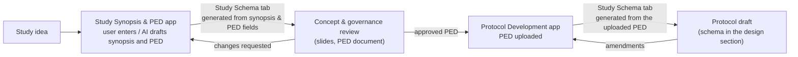

# Study Schema tab in Evidence CoPilot: requirements and user cases

This document states **what the Study Schema tab must achieve for its users and why**, independent of how it's built. It's the basis for prioritising and accepting the work.

- **Context:** the Study Schema is **not a standalone app**. It's a **tab inside Evidence CoPilot**, used in two of its apps: **Study Synopsis & PED** and **Protocol Development**.
- **Relation to other documents:**
  - This repository's app is a **prototype** used to explore and validate the ideas.
  - [`layout-behaviour-spec.md`](layout-behaviour-spec.md) describes how the prototype behaves. It's **one reference implementation**: its algorithms, thresholds and visual devices may be replaced if the outcomes below are met.
- **Status:** draft for review with the tech team, October 2026. Items marked **[to confirm]** need a product or platform decision.

---

## 1. Why the tab exists

Every study needs a **study design figure** that shows, on one page:
- who enters
- how participants are assigned or grouped
- what each group receives
- in what order and for how long
- when the key outcomes are measured

The figure appears in the synopsis and PED reviewed by governance, in slides for review meetings and advisory boards, and in the final protocol.

Today teams draw it by hand in PowerPoint. That causes four problems:

1. **It lags behind the design.** Every change to the synopsis or PED means redrawing, so the figure often shows an older version of the study.
2. **It doesn't fit where it goes.** Protocol and PED pages are portrait Word pages, while review-meeting slides are landscape. A figure drawn for one rarely fits the other without being redrawn or shrunk until it's unreadable.
3. **It misses expected content**, such as the allocation ratio, period durations, the index date and windows for RWE studies, or the counts in a participant flow.
4. **It's inconsistent across studies and teams**, which slows review.

In Evidence CoPilot the study information already exists as structured input: the synopsis and PED in one app, and the uploaded PED in the other. The tab turns that information into the figure, keeps it **legible on the page it's destined for**, lets the author **refine** it, and keeps it **in step with the source** as the study design evolves.

## 2. Where the tab sits in the user journey

| | Study Synopsis & PED app | Protocol Development app |
| --- | --- | --- |
| **Source of the schema** | The user's input in the synopsis and PED (structured fields, AI-drafted or typed) | The uploaded, usually approved, PED |
| **Maturity of the design** | Evolving: frequent edits, options being compared | Largely fixed: changes come through review comments or amendments |
| **Main destinations** | Review-meeting slides (landscape), the PED document (portrait), discussion with the team | The protocol document (portrait), slides for investigator meetings or vendors |
| **Main users** | Study lead / evidence generation lead, RWE scientist, statistician | Medical writer, study lead, reviewers / approvers |

## 3. Users

| User | Role in the journey | What they need from the tab |
| --- | --- | --- |
| **Study lead** (Medical Affairs / evidence generation) | Owns the synopsis and PED; presents the study for approval | A clear figure as soon as the design is entered; easy to adjust; slide-ready |
| **RWE scientist / epidemiologist** | Designs database and non-interventional studies | Correct timing relative to the index date; auditable cohort selection |
| **Statistician** | Checks the design, groups, allocation and endpoint timing | Allocation, ratio, group sizes and assessment timing are unambiguous |
| **Medical writer** | Builds the protocol from the approved PED | A schema that matches the PED, fits the protocol page, and drops into the document |
| **Reviewer / approver** (e.g. study review committee) | Reviews the synopsis, PED and protocol | Can understand the design in seconds and trust that the figure matches the text |

## 4. Real-life user cases

Each case follows the same pattern: *situation → what the figure must communicate → therefore → expected outcome*. The examples are real synopses the prototype has been tested with, plus typical designs.

*"Therefore"* describes what the content demands, not a prescribed visual design. Any design that communicates the same things equally clearly is acceptable.

### UC1. First draft of a non-interventional study in the synopsis
*Study Synopsis & PED app. Example: prospective cohort of amivantamab in EGFR-mutated NSCLC, 24 months enrolment and 12 months follow-up.*

- **Situation:** the study lead has filled in the population, design, data source and durations, and opens the Study Schema tab to see whether the design "reads" before sharing it with the team.
- **Must communicate:**
  - the population and where the data come from (eCRF)
  - that this is a single real-world cohort, with no assignment
  - enrolment and follow-up durations
  - the primary endpoint and when it's measured
- **Therefore:**
  - a short left-to-right sequence on one line
  - periods shown as labelled groups with their durations
  - the overall study duration (36 months) noted, **not** drawn as a step
  - no assignment symbol, because none exists
- **Expected outcome:**
  - the schema appears **without extra work** from what was entered
  - anything the figure needs but the synopsis doesn't contain (e.g. sample size still a placeholder) is listed, and each item **points to the synopsis field to complete**

### UC2. Synopsis revised after team feedback
*Study Synopsis & PED app.*

- **Situation:** the team asks to add a second cohort and extend follow-up. The study lead had already re-coloured boxes and shortened two labels for a slide.
- **Must communicate:** the updated design.
- **Therefore:** the schema follows the synopsis.
- **Expected outcome:**
  - the schema updates to the new design
  - the user's **refinements are kept where they still apply** (colours, label edits, chosen orientation); anything that couldn't be kept is reported
  - the user can see **what changed** compared with the previous version
  - nothing changes behind the user's back: the update is either explicit ("Update from synopsis") or announced **[to confirm which]**

### UC3. Concept review meeting slide
*Study Synopsis & PED app. Example: Phase 3 parallel RCT, 2:1 randomisation, stratified by two factors.*

- **Situation:** the study lead presents the design to the study review committee on a 16:9 slide.
- **Must communicate:**
  1. population and planned N
  2. randomisation with ratio and stratification factors
  3. what each arm receives
  4. period order and durations (screening → treatment → follow-up)
  5. when the primary endpoint is assessed
- **Therefore:**
  - one reading direction that represents time
  - periods as ordered, labelled groups
  - a visibly distinct assignment point
  - arms side by side at the same point in time, so they read as concurrent
- **Expected outcome:**
  - a **landscape, single-line** figure that reviewers grasp at a glance
  - exported to PowerPoint as **editable shapes and text**, so last-minute wording changes don't need a redraw

### UC4. Schema in the PED document
*Study Synopsis & PED app.*

- **Situation:** the PED is exported or shared as a Word document with portrait pages.
- **Must communicate:** the same content as UC3.
- **Therefore:** the figure must be re-arranged for a portrait page, not rotated or shrunk.
- **Expected outcome:**
  - the schema fits **one portrait page with legible text**
  - if a left-to-right arrangement can't be legible on portrait, the figure re-arranges (e.g. top-to-bottom, or continues on further lines) or the user is told how small the text will print

### UC5. Protocol development from the approved PED
*Protocol Development app. Example: TITAN-like long oncology trial (screening, treatment, end of treatment, follow-up, open-label extension, long-term extension).*

- **Situation:** the medical writer uploads the approved PED. The Study Schema tab generates the schema from it for the protocol's design section.
- **Must communicate:**
  - the full study journey in the correct order
  - which period each step belongs to, with durations
  - randomisation with ratio and stratification
  - the treatment of each arm
  - the primary endpoints
- **Therefore:**
  - when one line would be too small to read, the sequence **continues on further lines** in reading order rather than shrinking
  - a period continuing on the next line is **marked as continued**
  - the path between lines is unambiguous
- **Expected outcome:**
  - one portrait page with legible text
  - the schema **matches the PED**: any element in the PED that isn't represented, or that conflicts with it, is flagged
  - the writer can insert the figure into the protocol document directly

### UC6. Real-world database study
*Either app. Example: comparative effectiveness of apalutamide, enzalutamide and triplet therapy in mHSPC from European RWD.*

- **Situation:** the RWE scientist defines data sources, eligibility steps, exposure groups, the index date and follow-up.
- **Must communicate:**
  - **Design diagram:** the index date (Day 0) and when each window applies relative to it (baseline/covariate assessment, exposure, follow-up with its end rule).
  - **Cohort selection:** each selection step in order, with the number excluded and why, then the split into exposure groups.
- **Therefore:**
  - a shared time reference with Day 0 marked
  - every window shows its day range; open-ended follow-up is visibly open-ended
  - **readability of short windows takes priority over proportional scale**
  - selection drawn as a sequential chain, with exclusions beside the step they belong to
- **Expected outcome:**
  - an epidemiologist reviewer can verify timing and attrition against the PED
  - placeholders for counts are obvious until real numbers exist

### UC7. Expert consensus study
*Either app. Example: Delphi consensus on bladder cancer practice standards.*

- **Situation:** the study is a Delphi with two or three survey rounds and a final consensus meeting.
- **Must communicate:**
  - panel recruitment and panel size
  - the rounds with feedback between them
  - that round 3 is optional
  - the consensus meeting and the consensus definition (e.g. ≥ 70 % agreement)
  - participation per round
- **Therefore:** a process sequence with optional steps visibly optional, plus a participation flow per round.
- **Expected outcome:** reviewers understand the process without reading the methods section.

### UC8. A design where groups change treatment over time
*Either app. Examples: randomised withdrawal (responders re-randomised at week 24), stepped-wedge cluster trial (hospitals switch to the intervention every 3 months).*

- **Situation:** a standard box-and-arrow schema can't show who gets what when.
- **Must communicate:**
  - which group receives what **at which time**
  - where groups split or are re-randomised, with the ratio
  - key milestones (e.g. response assessment)
  - the total time span
- **Therefore:**
  - groups as **parallel tracks on a real time scale**, with movements between tracks shown explicitly
  - long uneventful stretches may be **compressed, provided the compression is marked**
- **Expected outcome:** the reader can reconstruct each group's treatment sequence and its timing.

### UC9. Treatment-pattern study
*Either app.*

- **Situation:** an RWE study describes how patients move from first-line to later-line therapy.
- **Must communicate:** the order of lines, the regimens per line, the event that moves patients to the next line, and the regimen of interest.
- **Expected outcome:** lines read in order, with transitions visible.

### UC10. Protocol amendment
*Protocol Development app.*

- **Situation:** an amendment extends follow-up and adds an assessment.
- **Must communicate:** the amended design.
- **Expected outcome:**
  - the schema is updated from the amended source
  - the **previous version stays available** with the previous protocol version
  - the differences are visible **[to confirm: version handling is a platform capability]**

### UC11. Reviewer reads the schema
*Either app.*

- **Situation:** a committee member opens the synopsis, PED or protocol to review it.
- **Expected outcome:**
  - the schema is visible **read-only**
  - it's consistent with the text being reviewed
  - comments can be attached in the same way as elsewhere in Evidence CoPilot **[to confirm]**

### UC12. The author overrides the automatic arrangement
*Either app.*

- **Situation:** the system chose a top-to-bottom layout for the PED page, but the team's slide template needs left-to-right; or the writer needs the conventional vertical layout for a participant flow.
- **Expected outcome:**
  - the user's explicit choice of direction, page orientation or number of lines is **respected and never overridden automatically**
  - if that choice makes text too small, the system **warns** rather than changing it

### UC13. The design grows while drafting
*Study Synopsis & PED app.*

- **Situation:** arms, periods and longer descriptions are added as the synopsis matures.
- **Expected outcome:**
  - the figure stays coherent: groups intact, order preserved, consistent spacing and alignment
  - it stays legible by re-arranging (more lines, or the other orientation) before text falls below the minimum
  - when legibility can't be reached, the user is told how small the text will print and what would help (e.g. shorter labels)

## 5. Requirements

Priority: **Must** = needed for the tab to be useful; **Should** = expected, can follow; **Could** = valuable later.

### 5.1 Integration with Evidence CoPilot

| ID | Requirement (outcome) | Priority | Acceptance (observable) | Cases |
| --- | --- | --- | --- | --- |
| I1 | **Generated from platform data.** In Study Synopsis & PED the schema is built from the synopsis/PED input; in Protocol Development, from the uploaded PED. No separate data entry. | Must | Opening the tab on a completed synopsis or uploaded PED shows a schema without extra input. | UC1, UC5 |
| I2 | **Gaps point back to the source.** Information the figure needs but the source lacks is listed and linked to the field (synopsis) or section (PED) to complete. | Must | Each listed gap navigates to its field or section. | UC1, UC5, UC6 |
| I3 | **Stays in step with the source.** When the synopsis/PED changes, the user is told the schema is out of date and can update it in one action **[to confirm: automatic vs on request]**. | Must | Edit a source field → the tab shows "out of date"; the update reflects the change. | UC2, UC10 |
| I4 | **Refinements survive updates.** On update, user refinements (colours, label edits, orientation, number of lines) are kept where the element still exists; anything dropped is reported. | Must | Refine, change the source, update → refinements kept; dropped ones listed. | UC2 |
| I5 | **Consistency with the PED.** In Protocol Development, elements in the PED that aren't in the schema, or that conflict with it, are flagged. | Should | Removing an arm from the schema flags a mismatch with the PED. | UC5 |
| I6 | **Into the documents.** The schema can be placed into the documents the platform produces (PED, protocol) at the page size and orientation of that document. | Must | The generated Word document contains the schema fitted to its page. | UC4, UC5 |
| I7 | **Versions follow the document.** Each synopsis/PED/protocol version keeps its schema; previous versions can be viewed and compared. | Should | After an amendment, the previous schema is still viewable with its version. | UC10 |
| I8 | **Platform roles.** Editing follows the platform's permissions; reviewers see the schema read-only. | Must | A reviewer can view but not edit. | UC11 |
| I9 | **Comments** on the schema use the platform's review/comment mechanism. | Could | A comment can be attached and resolved. | UC11 |

### 5.2 The figure

| ID | Requirement (outcome) | Priority | Acceptance (observable) | Cases |
| --- | --- | --- | --- | --- |
| R1 | **Target page.** The user can choose the target page and orientation: portrait or landscape document page, or 16:9 slide. Placement into a document uses that document's page (I6). | Must | Each option can be selected; the preview and export use it. | UC3, UC4 |
| R2 | **Re-arrange for the page.** Changing orientation re-arranges the figure to use the page; it doesn't merely scale or rotate it. | Must | A schema that fits landscape on one line produces a different, legible arrangement on portrait. | UC3, UC4 |
| R3 | **Legibility floor.** Printed text on the target page must not fall below an agreed minimum **[to confirm: 8 pt proposed]**. If unavoidable, the user is warned with the expected print size. | Must | The printed size is shown; a warning appears below the minimum. | UC4, UC5, UC13 |
| R4 | **One reading direction.** Each figure reads in one consistent direction that represents sequence or time. Arrows don't run backwards except for genuine loops. | Must | No backward arrows in generated figures of the reference set (§7). | UC1, UC3, UC5, UC6 |
| R5 | **Groups intact and ordered.** Every element of a period, stage or line stays within its group's area. Groups appear in chronological order, labelled with name and duration. | Must | Each element is inside its group area; group order equals period order. | UC1, UC3, UC5 |
| R6 | **Growth by continuation, not shrinking.** When content exceeds the page at legible size, the figure continues on further lines (rows or columns) in reading order. | Must | Long reference schemas produce more than one line with text at or above the minimum. | UC5, UC6, UC13 |
| R7 | **Visible continuation.** A group continuing on the next line is marked as continued. The path between lines is unambiguous: one connector, crossing no content. | Must | The continued group is labelled; the connector crosses no boxes. | UC5 |
| R8 | **Branches beside the main path.** Side information (exclusions with reasons, notes such as stratification) sits beside the step it belongs to, without interrupting the main path or overlapping content. | Must | No overlaps; each exclusion is adjacent to its step. | UC3, UC6 |
| R9 | **Concurrent groups side by side.** Arms or cohorts at the same point in time are aligned side by side. | Must | Arms share a column (horizontal) or row (vertical). | UC3, UC5 |
| R10 | **User choice wins.** Explicit choices of direction, orientation and number of lines are never overridden automatically. | Must | After an explicit choice, no automatic action changes it. | UC12 |
| R11 | **No silent loss of edits.** Texts, colours, shapes and connections survive re-arrangement. Any re-arrangement that resets manual positions is predictable and undoable in one step. | Must | Edit, re-arrange, undo once → identical figure. | UC2, UC12 |
| R12 | **What you see is what you get.** Document placement, PowerPoint (editable shapes) and images match the screen on the chosen page. | Must | Visual comparison of screen and outputs on the reference set. | UC3–UC5 |
| R13 | **Expected content per diagram type.** Each diagram type contains the elements reviewers and reporting guidelines expect: allocation, ratio, interventions and period timing for trials (SPIRIT, ICH M11); stages and counts for participant flows (CONSORT, STROBE/RECORD); windows relative to Day 0 for database studies (HARPER, RECORD-PE); rounds and participation for consensus studies (ACCORD). | Must | Content checklist passes for the reference set. | UC3, UC5–UC8 |
| R14 | **Sensible default.** Without explicit choices, the system picks the most legible arrangement on the natural page for the reading direction (left-to-right → landscape, top-to-bottom → portrait), preferring fewer lines when legibility is similar. | Should | Defaults on the reference set meet R3 where physically possible. | UC1, UC3, UC13 |
| R15 | **Diagram types per study type.** The tab offers the figures that suit the study: design schema (all); participant flow; design diagram around the index date (database studies); treatment lines (treatment-pattern studies); time-based tracks (designs where groups change treatment over time); process diagram (consensus studies). | Must | For each reference study the suitable figures are offered. | UC1, UC6–UC9 |
| R16 | **Time scale with marked compression** for time-based figures. | Should | Compressed intervals are marked on the axis and explained in a note. | UC6, UC8 |
| R17 | **Explain automatic changes.** When the system re-arranges for legibility (more lines, other direction), it says what it did. | Should | Info text names lines, orientation and print size. | UC12, UC13 |
| R18 | **Pin manual positions** so they survive re-arrangement and source updates. | Could | Pinned boxes keep their position. | UC2 |

The team's summary maps onto this as follows:

| Team's summary | Requirements |
| --- | --- |
| Support for portrait and landscape layouts | R1, R2, R14, I6 |
| Improved wrapping and positioning of nodes within groups | R5–R9 |
| A visually coherent layout that stays readable as schemas grow | R3, R4, R6, R7, R12, R17 |
| *Additionally, from the platform context* | I1–I4, I6, I8 (generated from and kept in step with the synopsis/PED, placed into documents, roles); R10/R11 (never surprise the user or lose work); R13/R15 (the right content and figure types) |

## 6. Scope: what's fixed, what's open, what's out

**Fixed (business requirements):**
- the schema is generated from Evidence CoPilot's synopsis/PED data and kept in step with it
- one page per figure on the target page
- a legibility floor, with a warning when it can't be met
- one consistent reading direction representing time or sequence
- groups intact and chronological, continuations marked
- side information beside, not inside, the main path
- user choices respected
- no silent loss of edits
- faithful, editable outputs
- the expected content per study type

**Open (implementation choices for the team):** the prototype chose the items below. Each may be replaced if the requirements are still met.

| Topic | Prototype's choice | Freedom |
| --- | --- | --- |
| Layout engine | ELK layered with periods as partitions | Any engine or custom algorithm |
| Exact thresholds | Keep one line if ≥ 9 pt; switch only if > 10 % larger; tie zone 7 % | Tune freely; only the legibility floor (R3) is a requirement |
| Maximum lines | 4 | Product decision **[to confirm]** |
| How lines are cut | Scoring (widest line, crossing arrows, period splits, side boxes, evenness) | Any method meeting R5–R7 |
| Connector between lines | Runs along a lane, enters the next line from outside the group area | Any unambiguous connector (R7) |
| Automatic direction switch | May switch left-to-right ↔ top-to-bottom when clearly more legible, unless the user chose a direction | Could instead **suggest** the switch **[to confirm]** |
| Group visuals | Tinted bands, outlines or label chips; "(cont.)" suffix | Any visual meeting R5/R7 |
| Position resets | Re-arrangement recomputes positions; a direction change resets manual sizes and arrow attachments | Free, provided R11 holds; R18 can remove resets |
| Data model | The prototype's `StudyModel` JSON | Map from the platform's synopsis/PED data model **[to confirm field mapping]** |

**Out of scope for the platform tab:** these exist in the prototype only to make it usable on its own.
- document upload and the "Analyse with AI" panel; in the platform, synopsis/PED content arrives from the host apps
- the prototype's own AI calls and bring-your-own-key mode; the platform's AI services are used
- example templates, project files (save/open) and browser autosave
- the prototype's guideline checklist panel; the content checks of R13 should surface the platform's way **[to confirm]**
- GitHub Pages and Domino hosting

## 7. Reference set for acceptance

Accept the work against **real studies and typical designs**, each in both portrait and landscape and in both apps where applicable:

- **Real synopses tested with the prototype:**
  - Amivantamab prospective cohort (UC1)
  - Delphi bladder cancer consensus (UC7)
  - comparative-effectiveness RWE study in mHSPC (UC6)
  - TITAN-like long oncology RCT (UC5)
- **Typical designs:** parallel RCT (UC3), crossover, dose escalation with expansion, basket trial, randomised withdrawal and stepped-wedge (UC8), new-user database cohort, case-control, external control arm, treatment patterns (UC9).

The README gallery shows the prototype's output for most of these.

## 8. Open questions for decision

1. **Updates from the source:** should the schema update automatically when the synopsis/PED changes, or only when the user clicks "Update"?
2. **Field mapping:** which synopsis and PED fields feed the schema? The prototype needs population, design and allocation, periods with durations, arms or cohorts, selection steps, index date and windows, lines of therapy, timeline events and endpoints.
3. **Documents:** where exactly is the schema inserted in the PED and protocol templates, and at what page size?
4. **Legibility floor:** is 8 pt the right minimum?
5. **Automatic direction change:** may the system switch the reading direction itself, or only suggest it?
6. **Manual positions:** is pinning (R18) needed for the first release?
7. **Versions and comments:** can the tab reuse the platform's versioning and commenting?
